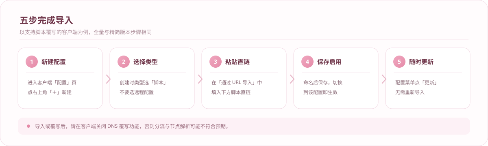

<div align="center">
  
</div>

# 桃白簪花

面向 **mihomo（Clash Meta）内核**的配置整理方案：一份覆写脚本 + 两份成品配置，把机场订阅里的节点重新编排成结构清晰、开箱可用的策略组体系。

它的取舍只有两句话：

- **命名说人话** —— 策略组用服务名和地区名，面板里一眼能看懂，不用靠意象猜。
- **开关集中在一处** —— 脚本顶部的 `ruleOptionsEnable` 就是总控台，改一个 `true` / `false` 就能增删功能。

> 本仓库只提供配置与脚本，不提供、不存储、不分发任何订阅链接或节点信息。

---

## 它想解决的四件事

**一、节点一团乱麻**
订阅里几十上百个节点，名字长短不一、地区混杂、倍率不明。脚本会按识别规则把它们归入香港 / 日本 / 美国 / 新加坡 / 台湾五个地区，再按倍率与住宅属性单独拆出低倍率、高倍率、家宽三组，剩下的收进「其他节点」。

**二、DNS 被机场私有化**
越来越多机场用私有 DNS 解析自家节点域名，甚至用 hosts 把域名指到回环地址，普通覆写手段直接失效。脚本会接管节点域名的解析路径，避免解析失败或被导向劣质线路。

**三、国内外误判**
不少方案用「域名在国内就直连」兜底，遇到 CDN 与国内可用但域名在外的服务就出错。这里的兜底换成了 IP 判定，域名层只承担 DNS 分流，减少误走代理和误直连两头的问题。

**四、规则臃肿**
规则以 `rule-set` 形式按需拉取，只加载用得上的部分，启动快、内存占用低。

---

## 三种用法

| 用法 | 文件 | 适合谁 |
| --- | --- | --- |
| 成品配置 · 全量 | `Config/mihomoConfig.yaml` | 想直接导入就能用，不需要自动分组 |
| 覆写脚本 · 全量 | `Script/mihomoScript.js` | 有自己的机场订阅，希望节点自动归类 |
| 覆写脚本 · 精简 | `Script/Script.js` | 同上，但只保留常用分流，配置更短 |

两个版本的分组逻辑完全一致，差别只在分流组的数量：全量版 46 个策略组、22 个分流组；精简版 28 个策略组，分流组只保留 Google、AI、Telegram、Steam 与 AdBlock。

---

## 策略组结构

**基础组**

| 组名 | 作用 |
| --- | --- |
| 默认代理 | 全局默认出口，分流组的默认落点 |
| 手动选择 | 手动指定具体节点 |
| 自动选择 | 按延迟自动测速择优 |
| 负载均衡 | 多节点按权重分摊 |

**分流组（22 个，可逐个开关）**

FCM · YouTube · Google · AI · GitHub · Microsoft · Apple · Telegram · Steam · TikTok · Twitter · Meta · Line · Netflix · Emby · PikPak · Spotify · Crypto · PayPal · Patreon · EHentai · AdBlock

**地区组（5 个）**

香港 · 日本 · 美国 · 新加坡 · 台湾

每个地区组可再分出「XX-自动选择」，也可以把手动选择组隐藏起来，只留下自动档。

**倍率与属性组（3 个）**

低倍率节点 · 高倍率节点 · 家宽节点 —— 按节点标注的倍率与「住宅 / 原生 IP」字样自动归类，方便按成本取舍。

**收尾**

其他节点 · 漏网之鱼 · 直连 · GLOBAL。未命中任何规则的流量最终落到「漏网之鱼」。

---

## 图标体系

全部 40 枚图标为自制：48 × 48 画布、圆角方形底、桃粉渐变（`#F0A8C0 → #E58BA8`）、白色符号，成组摆放时颜色与造型统一。`Icons/svg/` 下是矢量原件，`Icons/png/` 是对应的 144 × 144 位图，给不认 SVG 的旧客户端兜底。

<table>
<tr>
<td align="center"><br><sub>主控</sub></td>
<td align="center"><br><sub>自动</sub></td>
<td align="center"><br><sub>手动</sub></td>
<td align="center"><br><sub>负载均衡</sub></td>
<td align="center"><br><sub>漏网之鱼</sub></td>
<td align="center"><br><sub>直连</sub></td>
<td align="center"><br><sub>全局</sub></td>
<td align="center"><br><sub>自建</sub></td>
</tr>
<tr>
<td align="center"><br><sub>香港</sub></td>
<td align="center"><br><sub>日本</sub></td>
<td align="center"><br><sub>美国</sub></td>
<td align="center"><br><sub>新加坡</sub></td>
<td align="center"><br><sub>台湾</sub></td>
<td align="center"><br><sub>其他节点</sub></td>
<td align="center"><br><sub>低倍率</sub></td>
<td align="center"><br><sub>高倍率</sub></td>
</tr>
<tr>
<td align="center"><br><sub>家宽</sub></td>
<td align="center"><br><sub>链式落地</sub></td>
<td align="center"><br><sub>YouTube</sub></td>
<td align="center"><br><sub>Google</sub></td>
<td align="center"><br><sub>AI</sub></td>
<td align="center"><br><sub>GitHub</sub></td>
<td align="center"><br><sub>Microsoft</sub></td>
<td align="center"><br><sub>Apple</sub></td>
</tr>
<tr>
<td align="center"><br><sub>Telegram</sub></td>
<td align="center"><br><sub>Twitter</sub></td>
<td align="center"><br><sub>Meta</sub></td>
<td align="center"><br><sub>Line</sub></td>
<td align="center"><br><sub>TikTok</sub></td>
<td align="center"><br><sub>Steam</sub></td>
<td align="center"><br><sub>Netflix</sub></td>
<td align="center"><br><sub>Spotify</sub></td>
</tr>
<tr>
<td align="center"><br><sub>Emby</sub></td>
<td align="center"><br><sub>PikPak</sub></td>
<td align="center"><br><sub>FCM</sub></td>
<td align="center"><br><sub>加密</sub></td>
<td align="center"><br><sub>PayPal</sub></td>
<td align="center"><br><sub>Patreon</sub></td>
<td align="center"><br><sub>EHentai</sub></td>
<td align="center"><br><sub>广告拦截</sub></td>
</tr>
</table>

---

## 导入



下面每条链接各占一行，每行右上角有独立的复制按钮，点一次只复制这一条，不会把两条一起粘进去。

### 全量版（功能最全）

**成品配置 · 全量**

```
https://raw.githubusercontent.com/JokerXiaoMo/taobai-zanhua/main/Config/mihomoConfig.yaml
```

**覆写脚本 · 全量**（配合你自己的机场订阅使用）

```
https://raw.githubusercontent.com/JokerXiaoMo/taobai-zanhua/main/Script/mihomoScript.js
```

### 精简版（只留常用分流，配置更短）

**成品配置 · 精简**

```
https://raw.githubusercontent.com/JokerXiaoMo/taobai-zanhua/main/Config/mihomoConfigLite.yaml
```

**覆写脚本 · 精简**（配合你自己的机场订阅使用）

```
https://raw.githubusercontent.com/JokerXiaoMo/taobai-zanhua/main/Script/Script.js
```

> 怎么选：成品配置直接导入即用；覆写脚本用于覆写你手上的机场订阅，请勿用它去覆写手写的配置。导入后记得关掉客户端的 DNS 覆写选项，否则 DNS 分流会被客户端接管，和配置里的设定打架。

---

## 开关一览

所有开关都在脚本顶部的 `ruleOptionsEnable` 里。

| 开关 | 默认 | 作用 |
| --- | --- | --- |
| 手动选择 | 开 | 是否生成手动选择组 |
| 自动选择 | 开 | 是否生成自动测速组 |
| 负载均衡 | 开 | 是否生成负载均衡组 |
| 极简国内外分流模式 | 关 | 只留一个出口，其余组一律不生成 |
| 生成地区自动选择组 | 开 | 每个地区额外生成「XX-自动选择」 |
| 隐藏地区手动选择组 | 关 | 把地区手动组藏起来，只看自动档 |
| 生成高低倍率组 | 开 | 生成低倍率 / 高倍率组 |
| 生成家宽节点组 | 开 | 生成家宽（住宅 / 原生 IP）组 |
| 分流组添加所有节点 | 关 | 分流组是否直接挂全部节点，而非只引地区组 |
| 过滤低倍率节点 | 关 | 从订阅中剔除低倍率节点 |
| 过滤高倍率节点 | 关 | 从订阅中剔除高倍率节点 |
| 过滤非地区节点 | 开 | 剔除识别不出地区的节点 |
| 屏蔽代理 QUIC 流量 | 关 | 拦截发往非国内目标的 443/UDP，避免 QUIC 绕过分流 |
| 代理 IPV4 优先 | 关 | 节点统一走 IPv4 |
| 代理 IPV6 优先 | 关 | 节点统一走 IPv6（与 IPv4 优先互斥） |
| 链式代理 | 关 | 自定义节点作为落地，经中转组转发 |

22 个分流组各自也有独立开关，按需关掉不用的即可，规则里对应的条目会一起消失。

---

## 目录

```
.
├── Config
│   ├── mihomoConfig.yaml       全量版配置，46 个策略组
│   └── mihomoConfigLite.yaml   精简版配置，28 个策略组
├── Script
│   ├── mihomoScript.js         全量版覆写脚本
│   └── Script.js               精简版覆写脚本
├── Icons
│   ├── svg                     40 枚矢量图标
│   └── png                     144 × 144 位图，供旧客户端使用
├── Rules                       少量随仓库分发的规则文件
├── Image                       文档示意图（矢量，本项目自绘）
├── Test                        脚本的测试用例
└── LICENSE
```

---

## 常见问题

**节点名怎么变了？**
脚本会按识别结果重写节点名，把地区和倍率标进名字里，这样分组和排序才有依据。原文会保留在客户端的原始订阅里。

**订阅更新之后要重新导入吗？**
不用。配置或脚本本身在客户端里点一次「更新」就会拉取，订阅的变化在下一次覆写时自动生效。

**图标在客户端里不显示？**
图标通过 `Icons/svg/` 的直链加载，需要客户端能联网访问。若使用的是不认 SVG 的客户端，可以换用 `Icons/png/` 下的同名片。

**为什么强调关掉 DNS 覆写？**
本方案把 `nameserver-policy`、`direct-nameserver`、`fake-ip-filter` 都写进了配置，客户端再用自己的 DNS 覆写会盖掉这些设定，导致国内域名被送出国、国外域名被直连。

---

## 来源与授权

- 脚本与配置的原始实现来自 [AIsouler/MyClash](https://github.com/AIsouler/MyClash)，以 MIT 协议发布。本仓库是该实现的镜像维护版本，`LICENSE` 保留原作者的版权声明。
- 40 枚图标、`Image/` 下的示意图，以及本文档的文字，均为本项目原创，随仓库一同以 MIT 协议提供。
- 仓库内不含任何客户端截图、他人图片或第三方素材；示意图全部是矢量自绘。
- 可自由使用、修改、再分发，保留 `LICENSE` 中的版权声明即可。

## 免责声明

本项目仅用于网络配置管理的学习与交流。请遵守所在地区的法律法规，不得用于任何违法用途。使用本仓库产生的任何后果由使用者自行承担。
